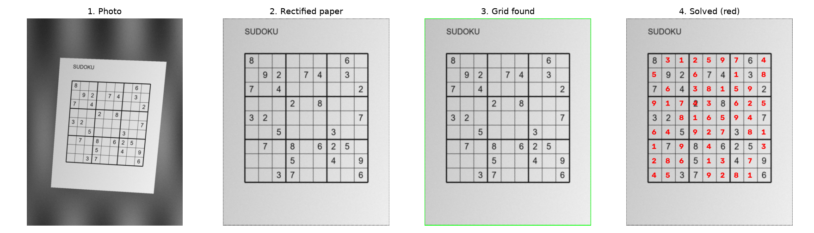

<h1 align="center">Machine-Learning-Coursework</h1>

  My homework and course project from the graduate Machine Learning course: seven homework sets and a Sudoku solver that works from a photo.
   
  MSc in Electrical Engineering (Control) at
  <a href="https://www.iust.ac.ir/">Iran University of Science and Technology</a>, Spring 1404 (2025).

  
  
  
  
  
  
  

  

  The Sudoku pipeline on a synthetic test photo: input, perspective-corrected sheet, Phase 2 outline, and the solved grid in red.

---

## What's in here

Each assignment has its own folder with:

- `report_en.pdf`: an **English summary in LaTeX** of what was asked, what I did and what came out, including the written (pen-and-paper) problems. The `.tex` source sits next to it, and all summaries share [`tex/preamble.tex`](tex/preamble.tex).
- the **notebooks and scripts** I wrote;
- `figures/`: plots taken from the notebook outputs;
- a short `README.md`.

The assignment sheets, notebook templates and datasets belong to their authors and are not included. Each README describes the task in my own words, and [`data/README.md`](data/README.md) says where to get each dataset.

## Assignments

| Folder | Topic | Highlights |
|---|---|---|
| [HW1](HW1-NumPy-and-MLE/) | NumPy, maximum likelihood | ML and MAP estimators derived for five densities |
| [HW2](HW2-Supervised-Regression/) | Supervised regression | Abalone linear regression, bias-variance decomposition, ridge = MAP |
| [HW3](HW3-KNN-and-Bagging/) | KNN and bagging | KNN from scratch tuned over K, bagging, naive Bayes, perceptron, Bayes' rule |
| [HW4](HW4-Feature-Selection-and-PCA/) | Feature selection, PCA | SelectKBest vs. RFE vs. random forest, PCA and t-SNE, kernel PCA by hand |
| [HW5](HW5-Support-Vector-Machines/) | SVMs | Dual soft-margin SVM solved with `cvxopt` (linear and RBF), kernel comparison |
| [HW6](HW6-MLP-in-PyTorch/) | Neural networks | MLP on MNIST (96.6 %), linear classifier on CIFAR-10, back-propagation by hand |
| [HW7](HW7-KNN-and-KMeans-from-Scratch/) | KNN, K-means, EM | From-scratch KNN and K-means that match scikit-learn, EM for a coin mixture |
| [**Sudoku project**](Sudoku-Solver-from-a-Photo/) | Computer vision + CNN | Perspective correction, grid detection, digit CNN, backtracking solver |

## How to run

Python 3.11 with the packages in [`requirements.txt`](requirements.txt). Put each dataset next to its notebook (see [`data/README.md`](data/README.md)) and run the notebook top to bottom. HW1-5 and HW7 were re-run for this repository with scikit-learn 1.9, pandas 3.1 and NumPy; HW6 keeps the outputs of my original Colab run. For the Sudoku demo, see its [README](Sudoku-Solver-from-a-Photo/README.md); it runs without TensorFlow.

Three submitted notebooks (HW3, HW4 and the HW7 KNN notebook) didn't run top to bottom. I made the smallest fixes needed and listed them in each folder's README.

## License

Code: [MIT](LICENSE).
