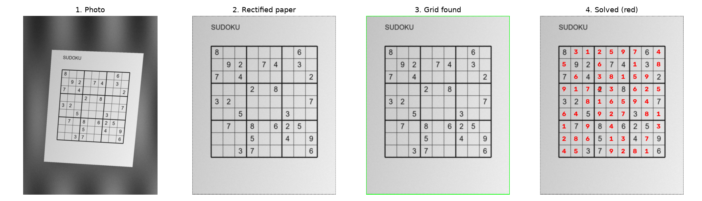

# Sudoku solver from a photo

My course project: take a phone photo of a printed Sudoku and return the solved grid drawn on the image, in four phases.

1. **Rectify the paper:** Canny edges, the largest contour, a four-corner fit and a perspective warp.
2. **Find the grid:** adaptive thresholding and the largest square-ish convex quadrilateral.
3. **Read the digits:** split the grid into 81 cells, isolate and centre each digit, and classify it with a CNN trained on printed digits.
4. **Solve:** backtracking search, then write the missing digits back on the image in red.



## Files

| File | What it is |
|---|---|
| [`sudoku.ipynb`](sudoku.ipynb) | The project notebook, all four phases (originally run on Colab; paths now relative) |
| [`sudoku.py`](sudoku.py) | The same code exported as a script |
| `models/digit_classifier.h5`, `models/improved_digit_classifier.h5` | The two trained Keras CNNs (simple, and deeper with batch norm, dropout and augmentation) |
| [`keras_numpy.py`](keras_numpy.py) | Runs the saved `.h5` models with NumPy only, so TensorFlow isn't needed for inference |
| [`make_test_photos.py`](make_test_photos.py) | Renders synthetic "phone photos" of random puzzles (`Test/`) |
| [`run_demo.py`](run_demo.py) | Runs phases 1-4 from `sudoku.py` on `Test/*.jpg`, writes `figures/` and `results.json` |
| [`evaluate_models.py`](evaluate_models.py) | Accuracy of both models on the printed-digits dataset, writes `model_accuracy.json` |
| [`report_en.pdf`](report_en.pdf) | English summary of the method and the checks below (LaTeX source next to it) |

## Run it

```bash
pip install numpy opencv-python h5py pillow matplotlib
python make_test_photos.py
python run_demo.py
```

To retrain the classifiers, open `sudoku.ipynb` with TensorFlow installed and the Kaggle digits dataset unzipped to `assets/assets/0..9` (see [`data/README.md`](../data/README.md)).

## What the checks show

The test photos used in the course aren't mine, so they aren't here. The demo uses three synthetic photos instead.

- **Classifiers** (all 6299 dataset images, training images included): simple model 98.8 %, improved model 97.4 % (its weakest class is "1", at 86.7 %).
- **Pipeline:** rectification and cell segmentation worked on all three photos. No clue was misread and no empty cell was read as a digit, but 14 of 35, 15 of 32 and 1 of 28 clues were missed. In those cells a piece of grid line stays inside the crop and is picked as the digit. With missed clues the solver returns a valid grid that differs from the intended one. I left the course code unchanged; a tighter crop or line removal before the contour step would fix it.
